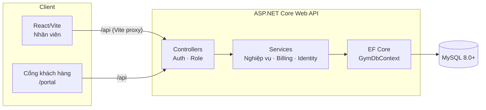

<div align="center">

# 🏋️ N6 Fitness Management

**Hệ thống quản lý phòng gym full-stack — ASP.NET Core Web API · EF Core · MySQL · React/Vite**


[Tính năng](#-tính-năng) •
[Kiến trúc](#-kiến-trúc) •
[Bắt đầu nhanh](#-bắt-đầu-nhanh) •
[API](#-api-endpoints) •
[Kiểm thử](#-kiểm-thử) •
[Xử lý sự cố](#-xử-lý-sự-cố)

</div>

---

## 📖 Giới thiệu

**N6 Fitness Management** là backend quản lý phòng gym theo mô hình **modular monolith**, kèm frontend React dành cho nhân viên và một **cổng khách hàng công khai**. Hệ thống bao phủ trọn vòng đời hội viên: đăng ký → mua gói → xuất hóa đơn → thanh toán → check-in → báo cáo.

> [!NOTE]
> Phạm vi MVP **không** gồm Redis, microservices, message queue hay cổng thanh toán bên thứ ba. Trạng thái chi tiết xem tại [README_PROGRESS.md](README_PROGRESS.md).

## ✨ Tính năng

| Module | Mô tả |
|---|---|
| 👤 **Hội viên** | CRUD, tìm kiếm, phân trang, ngừng hoạt động thay vì xóa cứng |
| 📦 **Gói tập** | Quản lý giá (`decimal`, 2 chữ số thập phân), thời hạn, trạng thái |
| 🔁 **Subscription** | Đăng ký, lịch sử, gia hạn |
| 🧾 **Hóa đơn** | Snapshot tên/giá/thời hạn gói tại thời điểm bán |
| 💳 **Thanh toán** | Xác nhận/từ chối nội bộ; payment + invoice + subscription cập nhật trong **một transaction** |
| ✅ **Check-in** | Yêu cầu hội viên active và subscription còn hiệu lực trong ngày (UTC) |
| 🧑‍🏫 **Huấn luyện viên** | Hồ sơ trainer, CRUD, trạng thái |
| 📊 **Báo cáo** | Doanh thu, hội viên, check-in, dashboard (mặc định 30 ngày UTC) |
| 📁 **File** | Upload/tải file, biên lai thanh toán |
| 🕵️ **Audit log** | Tra cứu nhật ký thao tác và danh sách actor |
| 🌐 **Cổng khách hàng** | Xem gói, tự đăng ký, tra cứu theo email/số điện thoại |

### 🔐 Bảo mật

- ASP.NET Core **Identity** băm mật khẩu, **khóa đăng nhập** sau 5 lần sai trong 15 phút.
- **JWT** ngắn hạn; đăng xuất cập nhật `SecurityStamp` để **thu hồi phiên tức thì**.
- Phân quyền theo role `Admin` / `Staff`; validation bằng DataAnnotations.
- Payment chỉ được xác nhận khi số tiền khớp invoice; chuyển khoản bắt buộc có mã tham chiếu.

## 🏗 Kiến trúc



### 🛠 Công nghệ

| Lớp | Công nghệ |
|---|---|
| Backend | .NET 10, ASP.NET Core Web API |
| ORM | EF Core 10 + `MySql.EntityFrameworkCore` 10.0.9 |
| Database | MySQL 8.0+ (đã kiểm tra với 8.0.46 / service `MySQL80`) |
| Auth | ASP.NET Core Identity + JWT Bearer |
| API docs | Swagger UI (Swashbuckle 10.2.3) |
| Frontend | React, React Router, Vite 8, lucide-react |
| Test | MSTest, EF Core InMemory / SQLite relational |

> [!WARNING]
> Provider `MySql.EntityFrameworkCore` dùng giấy phép **GPL-2.0 với FOSS Exception** — cần rà soát trước khi phân phối. Xem [README_ISSUES.md](README_ISSUES.md) và [README_DECISIONS.md](README_DECISIONS.md).

### 📂 Cấu trúc thư mục

```text
N6FitnessManagement/
├── src/
│   ├── GymManagement.Api/
│   │   ├── Controllers/   # HTTP endpoints + phân quyền theo role
│   │   ├── Services/      # Nghiệp vụ, Identity, billing, file
│   │   ├── Data/          # GymDbContext, migrations, mapping DateOnly ↔ DATE
│   │   ├── Models/        # Entity & enum trạng thái
│   │   ├── DTOs/          # Request/response & phân trang
│   │   └── Frontend/      # Bản static frontend cũ
│   └── GymManagement.Web/ # React/Vite frontend chính (nhân viên + portal)
├── tests/
│   └── GymManagement.Api.Tests/  # MSTest: service, portal, billing, end-to-end
└── docs/                  # Class diagram (HTML/PNG/SVG)
```

## 🚀 Bắt đầu nhanh

### Yêu cầu

- [.NET 10 SDK](https://dotnet.microsoft.com/)
- [Node.js](https://nodejs.org/) + npm
- MySQL 8.0+ đang chạy (MySQL Workbench tùy chọn)

### 1️⃣ Chuẩn bị database

```sql
CREATE DATABASE FitnessManagement;
```

### 2️⃣ Cấu hình local

Tạo `src/GymManagement.Api/appsettings.Development.json` (đã nằm trong `.gitignore`):

```json
{
  "ConnectionStrings": {
    "DefaultConnection": "Server=localhost;Port=3306;Database=<database>;User ID=<user>;Password=<local-secret>"
  },
  "Jwt": {
    "Issuer": "GymManagement.Api",
    "Audience": "GymManagement.Client",
    "AccessTokenMinutes": 30,
    "SigningKey": "<random-key-at-least-32-bytes>"
  },
  "BootstrapAdmin": {
    "Email": "<initial-admin-email>",
    "Password": "<strong-local-password>"
  }
}
```

Tạo signing key ngẫu nhiên:

```powershell
[Convert]::ToBase64String([Security.Cryptography.RandomNumberGenerator]::GetBytes(32))
```

> [!CAUTION]
> **Không** commit file này hay chép secret thật vào README. `BootstrapAdmin` tạo roles Admin/Staff và tài khoản Admin đầu tiên ở lần khởi động Development; có thể bỏ khi đã có Admin.

### 3️⃣ Chạy backend — terminal 1

```powershell
$env:ASPNETCORE_ENVIRONMENT = "Development"
dotnet run --project src/GymManagement.Api/GymManagement.Api.csproj --urls http://localhost:5187
```

> [!IMPORTANT]
> Ở Development, `Program.cs` tự gọi `Database.MigrateAsync()` — **schema của DB trong connection string sẽ bị thay đổi**. Hãy chắc chắn trỏ đúng database.

### 4️⃣ Chạy frontend — terminal 2

```powershell
cd src/GymManagement.Web
npm ci
npm run dev -- --host 127.0.0.1
```

### 🔗 Địa chỉ truy cập

| Thành phần | URL |
|---|---|
| Frontend nội bộ | http://127.0.0.1:5173/ |
| Cổng khách hàng | http://127.0.0.1:5173/portal |
| Swagger API | http://localhost:5187/swagger |

Vite proxy `/api` → `http://localhost:5187`, nên giữ backend chạy. Đăng nhập bằng tài khoản Admin/Staff đã được cấp.

<details>
<summary><b>🔑 Reset mật khẩu Admin bootstrap (chỉ Development)</b></summary>

Cờ chỉ bật một lần trong terminal, không lưu vào file cấu hình:

```powershell
$env:ASPNETCORE_ENVIRONMENT = "Development"
$env:BootstrapAdmin__ResetPassword = "true"
try { dotnet run --project src/GymManagement.Api/GymManagement.Api.csproj --urls http://localhost:5187 }
finally { Remove-Item Env:BootstrapAdmin__ResetPassword -ErrorAction SilentlyContinue }
```

Thao tác này đặt hash mật khẩu Admin về giá trị `BootstrapAdmin:Password` trong file local.

</details>

<details>
<summary><b>🗄 Quản lý migration thủ công</b></summary>

Chỉ dùng khi cần review hoặc cập nhật schema ngoài luồng khởi động. Xác nhận database đích trước khi chạy `database update`:

```powershell
$env:ASPNETCORE_ENVIRONMENT = "Development"
dotnet tool restore
dotnet ef migrations script --project src/GymManagement.Api --startup-project src/GymManagement.Api
dotnet ef database update --project src/GymManagement.Api --startup-project src/GymManagement.Api
```

Migrations hiện có: `InitialCreate` (15 `CREATE TABLE`, 0 `DROP TABLE`) và `AddStoredFilesAndPaymentReceipt`.

</details>

## 🗺 Bản đồ frontend

| Route | Mô tả | Quyền |
|---|---|---|
| `/login` | Đăng nhập nhân viên | Public |
| `/` | Dashboard tổng quan | Admin/Staff |
| `/members` `/plans` `/subscriptions` `/invoices` `/payments` `/checkins` `/trainers` `/reports` | Vận hành nội bộ | Admin/Staff |
| `/staff` | Tạo tài khoản nhân viên | Admin |
| `/portal/plans` `/portal/register` `/portal/lookup` | Cổng khách hàng | Public |

Access token lưu trong `sessionStorage`, không tự refresh trong MVP. Khi gặp `401`, frontend xóa phiên và chuyển về trang đăng nhập.

## 📡 API Endpoints

<details open>
<summary><b>Danh sách endpoint</b></summary>

| Nhóm | Endpoint | Quyền |
|---|---|---|
| **Auth** | `POST /api/auth/login` | Anonymous |
| | `POST /api/auth/logout` | Authenticated |
| **Users** | `GET /api/users/{id}` · `POST /api/users` | Admin |
| **Members** | `GET /api/members?search=&page=&pageSize=` · `GET /api/members/{id}` · `POST /api/members` · `PUT /api/members/{id}` · `PATCH /api/members/{id}/status` | Admin/Staff |
| **Plans** | `GET /api/membership-plans?search=&includeInactive=&page=&pageSize=` · `GET /{id}` · `POST` · `PUT /{id}` · `PATCH /{id}/status` | Admin/Staff |
| **Subscriptions** | `POST /api/subscriptions` · `GET /api/members/{memberId}/subscriptions` · `POST /api/subscriptions/{id}/renew` | Admin/Staff |
| **Invoices** | `GET /api/invoices?memberId=` · `GET /api/invoices/{id}` · `POST /api/invoices` | Admin/Staff |
| **Payments** | `GET /api/payments?invoiceId=` · `GET /api/payments/{id}` · `POST /api/invoices/{invoiceId}/payments` · `POST /api/payments/{id}/confirm` · `POST /api/payments/{id}/reject` | Admin/Staff |
| **Check-ins** | `POST /api/check-ins` · `GET /api/members/{memberId}/check-ins` | Admin/Staff |
| **Trainers** | `GET /api/trainers?search=&includeInactive=` · `GET /{id}` · `POST` · `PUT /{id}` · `PATCH /{id}/status` | Admin/Staff |
| **Reports** | `GET /api/reports/revenue` · `/members` · `/check-ins` · `/dashboard` (`?from=&to=`) | Admin/Staff |
| **Audit logs** | `GET /api/audit-logs` · `GET /api/audit-logs/actors` | Admin/Staff |
| **Portal** | `GET /api/portal/plans` · `POST /api/portal/register` · `GET /api/portal/lookup?query=` | Public |
| **Files** | `POST /api/files/upload` | Authenticated |
| | `GET /api/files/{id}` · `GET /api/files/{id}/download` | Public |
| | `DELETE /api/files/{id}` | Admin/Staff |

</details>

## 🧪 Kiểm thử

```powershell
dotnet test tests/GymManagement.Api.Tests/GymManagement.Api.Tests.csproj
```

Bộ test gồm **33 MSTest cases**: service tests (member, plan, subscription, check-in/report, file), invoice/payment transaction, portal controller và system end-to-end — chạy trên EF Core InMemory / SQLite relational.

> [!NOTE]
> Chưa có automated integration test với MySQL thật; các luồng login, members, dashboard đã được smoke-test thủ công trên MySQL local.

<details>
<summary><b>🔧 Build & kiểm tra từng phần</b></summary>

```powershell
# Build API
dotnet build src/GymManagement.Api/GymManagement.Api.csproj --no-incremental

# Build frontend + audit dependency
cd src/GymManagement.Web
npm ci
npm run build
npm audit --omit=dev
cd ../..
```

| Thành phần | Kết quả local |
|---|---|
| API build | ✅ 0 warning, 0 error |
| Frontend build | ✅ Vite 8.3.8 |
| Dependency audit | ✅ 0 vulnerability |
| MySQL local | ✅ Migration đã áp dụng; read, login, báo cáo đã smoke-test |

</details>

## 🩺 Xử lý sự cố

| Triệu chứng | Cách xử lý |
|---|---|
| Windows chặn `.dll`/`.exe` với mã `0x800711C7` | Do chính sách Application Control của máy, không phải lỗi API. Chạy trong terminal/IDE được cấp phép; **không** sửa/xóa DLL để né. |
| Port `5187` bị chiếm | Dùng `--urls http://localhost:5190` và cập nhật `server.proxy['/api'].target` trong `vite.config.js`. |
| Port `5173` bị chiếm | `npm run dev -- --host 127.0.0.1 --port 5174` |
| Frontend không kết nối API | Chạy API trước, kiểm tra `http://localhost:5187/swagger` và port proxy Vite. |
| Thiếu connection string / signing key | Kiểm tra `appsettings.Development.json` hoặc biến môi trường `ConnectionStrings__DefaultConnection`, `Jwt__SigningKey`. |
| Migration chạy nhầm database | Dừng API, kiểm tra `ASPNETCORE_ENVIRONMENT` và connection string trước khi chạy lại. |

## 📚 Tài liệu liên quan

- 📈 [README_PROGRESS.md](README_PROGRESS.md) — tiến độ & nhật ký phiên
- 🐞 [README_ISSUES.md](README_ISSUES.md) — vấn đề đã biết
- 🧭 [README_DECISIONS.md](README_DECISIONS.md) — quyết định kỹ thuật
- 🪟 [huysenseiTeachHowToRun.md](huysenseiTeachHowToRun.md) — hướng dẫn chạy chi tiết trên Windows
- 🧩 [docs/](docs/) — class diagram

---

<div align="center">

Made with 💪 by **Nhóm 6** — Lập trình Web 2

</div>
